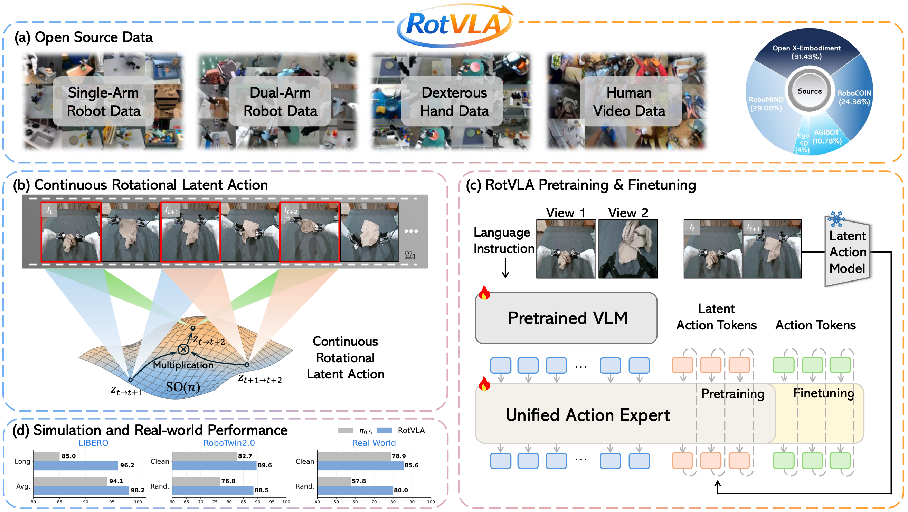

# RotVLA: RotVLA: Rotational Latent Action for Vision-Language-Action Model

**Qiwei Li**<sup>1,2</sup>, **Xicheng Gong**<sup>1</sup>, **Xinghang Li**<sup>2</sup>, **Peiyan Li**<sup>2,3</sup>, **Quanyun Zhou**<sup>2</sup>, **Hangjun Ye**<sup>2</sup>, **Jiahuan Zhou**<sup>1,†</sup>, **Yadong Mu**<sup>1,†</sup>

<sup>1</sup>Wangxuan Institute of Computer Technology, Peking University, <sup>2</sup>Xiaomi Robotics, <sup>3</sup>CASIA


<p align="center">
  <a href="https://qiweili00.github.io/rotvla-page/"></a>
  <a href="https://arxiv.org/abs/2605.13403"></a>
  <a href="https://huggingface.co/QiweiLi/RotVLA"></a>
</p>

---


<p align="center">
  
</p>

---

## News

- **[2026-09]** Released the code, datasets and checkpoints.
- **[2026-05]** RotVLA is on [arXiv](https://arxiv.org/abs/2605.13403).

---

## Installation

```bash
git clone https://github.com/qiweili00/RotVLA.git
cd RotVLA

conda create -n rotvla python==3.10 -y
conda activate rotvla

# Install dependencies
pip install -r requirements.txt
pip install lerobot==0.4.3 --no-deps
pip install numpy==1.26.4

# download flash-atten from https://github.com/Dao-AILab/flash-attention/releases
pip install flash-attn-xxx --no-build-isolation
```


---

## Data Preparation

All datasets must be converted to **LeRobot v3.0 format**. See [`data/README.md`](data/README.md) for detailed instructions.

The two **finetuning** datasets are released in already-converted form, so Stage 3 can be
reproduced without re-running the conversion pipeline. The pretraining corpora are large
and public — convert those from their original sources.

| Dataset | Stage | Source 
|---------|------|--------|
| [LIBERO](https://github.com/Lifelong-Robot-Learning/LIBERO) | Finetune | **converted: [HuggingFace](https://huggingface.co/datasets/QiweiLi/LIBERO-v3)** (4 suites, `no_noops`) |
| [RoboTwin](https://github.com/RoboTwin-Platform/RoboTwin) | Finetune | **converted: [HuggingFace](https://huggingface.co/datasets/QiweiLi/RoboTwin2-v3)** (50 tasks, `clean` + `randomized`) |
| [Open X-Embodiment](https://robotics-transformer-x.github.io/) | Pretrain | RLDS → LeRobot via [any4lerobot](https://github.com/Tavish9/any4lerobot) |
| [AgiBot World Alpha](https://huggingface.co/datasets/Traly/AgiBotWorld-Alpha-lerobot) | Pretrain | HuggingFace (Detailed in [`data/README.md`](data/README.md)) | 
| [RoboMIND](https://huggingface.co/collections/BAAI-DataCube/robomind-lerobot-v30-431-task-collection) | Pretrain | HuggingFace (Detailed in [`data/README.md`](data/README.md)) | 
| [RoboCOIN](https://flagopen.github.io/RoboCOIN-DataManager/) | Pretrain | LeRobot v2 → v3 via [any4lerobot](https://github.com/Tavish9/any4lerobot) | 
|  [Ego4D](https://ego4d-data.org/) | Pretrain | Processed following [UniVLA](https://github.com/OpenDriveLab/UniVLA), then → LeRobot v3 (Detailed in [`data/README.md`](data/README.md)) |

After downloading, update the `data_info` paths in your YAML config files under `core/config/`.


---
## Released Checkpoints

| Model | Description | Performance | Download |
|-------|-------------|-------------|----------|
| LAM | Pretrained Rotational Latent Action Model | - | [HuggingFace](https://huggingface.co/QiweiLi/RotVLA/tree/main/LAM-Pretrain) |
| Pretrain |  Pretrained RotVLA | - | [HuggingFace](https://huggingface.co/QiweiLi/RotVLA/tree/main/VLA-Pretrain) |
| LIBERO | RotVLA finetuned on LIBERO  | 98.2% | [HuggingFace](https://huggingface.co/QiweiLi/RotVLA/tree/main/VLA-Finetune-LIBERO) |
| RoboTwin | RotVLA finetuned on RoboTwin | 89.6%/88.5% | [HuggingFace](https://huggingface.co/QiweiLi/RotVLA/tree/main/VLA-Finetune-RoboTwin) |


## Evaluation

Evaluation lives in [`experiment/`](experiment/) and uses a client/server architecture.
One inference server serves both benchmarks — it dispatches on the `action_space`
recorded in the checkpoint config (`ee6d_libero` / `ee6d_robotwin`). The launcher
starts one replica per GPU (replica `i` listens on `port + i`), and each benchmark
has its own client scheduler that fans work out across those replicas.


### 1. Configure

Everything is driven by one YAML per benchmark:
[`experiment/config/libero.yaml`](experiment/config/libero.yaml) and
[`experiment/config/robotwin.yaml`](experiment/config/robotwin.yaml). Point
`server.ckpt` at your checkpoint directory and set `server.gpu_num` / `server.gpu_ids`:

```yaml
server:
  port: 8021
  gpu_num: 1              # one server replica per GPU
  gpu_ids: [0]
  ckpt: /path/to/VLA-Finetune-LIBERO
  time_step: 20
output_root: eval_result/libero
```

### 2. Start the server

Run from the RotVLA training environment. The launcher rewrites `server.host` in the
config to the local IP, so the client picks it up automatically:

```bash
cd experiment
./run_server.sh config/libero.yaml      # or config/robotwin.yaml
```

### 3. Run a client

**LIBERO** — install the LIBERO environment first, see the [official repo](https://github.com/Lifelong-Robot-Learning/LIBERO).

```bash
pip install mujoco==3.3.7   # LIBERO needs this exact version
export LIBERO_ROOT=/path/to/LIBERO      # repo containing the `libero` package

cd experiment/LIBERO
./run_client.sh ../config/libero.yaml
```

Schedules the four suites (`libero_spatial`, `libero_object`, `libero_goal`, `libero_10`)
in parallel.

**RoboTwin** — install the RoboTwin environment first, see the [official repo](https://github.com/RoboTwin-Platform/RoboTwin).

```bash
export ROBOTWIN_ROOT=/path/to/RoboTwin  # simulator repo (envs / task_config / description)

cd experiment/RoboTwin
./run_client.sh ../config/robotwin.yaml [num_client_gpus] [tasks_per_gpu]
```

Each entry under `eval_runs` in the config runs the task list (default: all 50 tasks)
with the given `params` — the shipped config evaluates both `demo_clean` and
`demo_randomized`. Only the single dual-arm embodiment is supported.

Results, logs and videos are written under `output_root/<tag>/`, where `<tag>` is
derived from the checkpoint path. Per-benchmark details are in
[`experiment/README.md`](experiment/README.md),
[`experiment/LIBERO/README.md`](experiment/LIBERO/README.md) and
[`experiment/RoboTwin/README.md`](experiment/RoboTwin/README.md).

---

## Training

All training is run from the `core/` directory.


### Pretrained model checkpoints required (not included in this repo):**
- `OpenGVLab/InternVL3_5-1B` — VLM backbone ([HuggingFace](https://huggingface.co/OpenGVLab/InternVL3_5-1B))
- ` DINOv2 ViT-B/14` — visual encoder for the LAM ([facebookresearch/dinov2](https://github.com/facebookresearch/dinov2))
- `UniVLA lam-stage-1` - initialization for LAM training ([HuggingFace](https://huggingface.co/qwbu/univla-latent-action-model))

### Stage 1: LAM Pretraining

Pretrain the Rotation Latent Action Model on large-scale heterogeneous datasets.

Set the path to the UniVLA lam-stage-1 checkpoint in the `stage_one_ckpt` field of [core/config/lam-stage-2-lerobot-latent.yaml](core/config/lam-stage-2-lerobot-latent.yaml)

```bash
cd core
bash stage1-latent-pretrain.sh
```

### Stage 2: VLA Pretraining

Pretrain the RotVLA on large-scale heterogeneous datasets.

```bash
cd core
bash stage2-vla-pretrain.sh
# Set lam_path= to the pretrained Rotational LAM checkpoint from Stage 1
```

### Stage 3: Downstream Finetuning

#### LIBERO

```bash
cd core
bash stage3-vla-finetune-libero.sh
# Set lam_path= to the pretrained Rotational LAM checkpoint from Stage 1
# Set resume_path= to the pretrained RotVLA checkpoint from Stage 2 (with resume_from_stage2=true)
```

#### RoboTwin

```bash
cd core
bash stage3-vla-finetune-robotwin.sh
# Set lam_path= to the pretrained Rotational LAM checkpoint from Stage 1
# Set resume_path= to the pretrained RotVLA checkpoint from Stage 2 (with resume_from_stage2=true)
```

All training scripts are [Hydra](https://hydra.cc/)-based: override any config key inline with
`key=value` (e.g. `trainer.lr=2e-4`, `trainer.data_mix=libero`, `save_dir=checkpoints/foo`),
and switch config file with `--config-name=<name>`.


---


## Training on a Custom Dataset

This section walks through how to finetune RotVLA on your own robot dataset.

### Step 1: Convert data to LeRobot v3.0 format

All datasets must be in [LeRobot v3.0 format](https://github.com/huggingface/lerobot). If your data is in another format, use [any4lerobot](https://github.com/Tavish9/any4lerobot) for conversion.

### Step 2: Register your dataset in the config YAML

Add your dataset to `core/config/data_info/all.yaml`, the shared lookup table pulled into
every config via the `data_info: all` defaults entry:

```yaml
data_info:
  my_robot_dataset:
    path: ${data.data_root}/my_robot_dataset     # or an absolute path
    view_map:
      image_1: observation.images.cam_high      # main camera
      image_2: observation.images.cam_wrist     # wrist camera (optional)
      # image_3: observation.images.cam_side    # up to 3 views supported
```

Paths are rooted at `data_root` at the top of that file; override it per machine with
`data.data_root=/other/path` on the command line. Entries not referenced by the active
mixture are ignored, so all configs can share one table.

The keys `image_1`, `image_2`, `image_3` are fixed names used internally. Map them to the actual image keys present in your LeRobot dataset's `info.json`.

### Step 3: Add a dataset mixture

Add a named mixture for your dataset in `core/dataset/mixtures.py`:

```python
OXE_NAMED_MIXTURES = {
    ...
    "my_custom_mix": [
        ("my_robot_dataset", 1.0),
        # add more datasets with relative sampling weights
        # ("another_dataset", 0.5),
    ],
}
```

### Step 4: Add a custom action space

The action space defines how actions are laid out, how loss is computed, and how gripper channels are handled. All action spaces live in [`core/dataset/action_hub.py`](core/dataset/action_hub.py).

Implement your class there and decorate it with a name of your choice:

```python
@register_action("my_robot")
class MyRobotActionSpace(BaseActionSpace):
    ...
```

The model head always outputs `dim_action=24` to stay compatible with pretrained weights. Your class maps between the model's 24-dim output and your robot's real action layout.

Registration happens at import time, so no other file needs editing — the name becomes
usable as soon as the class exists.

### Step 5: Run finetuning

Override the two keys on the command line:
```bash
cd core
bash stage3-vla-finetune-libero.sh   # or copy it as a starting point
# with:
#   trainer.action_space=my_robot
#   trainer.data_mix=my_custom_mix
```

---

## Citation

If you find this work useful, please cite:

```bibtex
@article{rotvla2026,
  title     = {RotVLA: Rotational Latent Action for Vision-Language-Action Model},
  author    = {Qiwei Li and Xicheng Gong and Xinghang Li and Peiyan Li and Quanyun Zhou and Hangjun Ye and Jiahuan Zhou and Yadong Mu},
  journal   = {arXiv preprint arXiv:2605.13403},
  year      = {2026}
}
```


---

## Acknowledgements

This work builds on: [UniVLA](https://github.com/OpenDriveLab/UniVLA), [Evo-1](https://github.com/MINT-SJTU/Evo-1), [F1-VLA](https://github.com/InternRobotics/F1-VLA)

